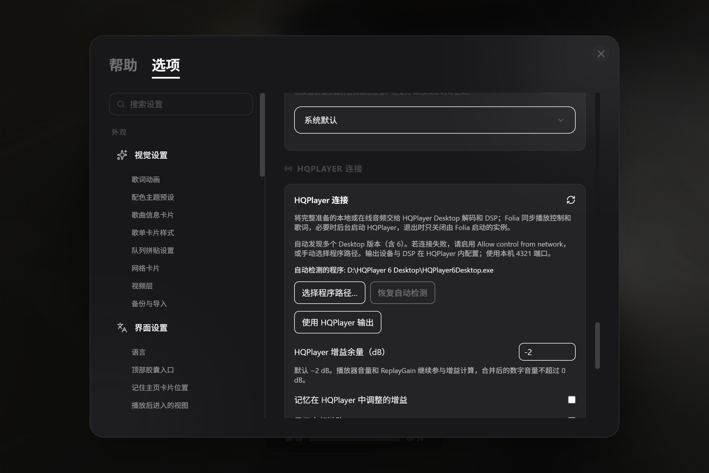
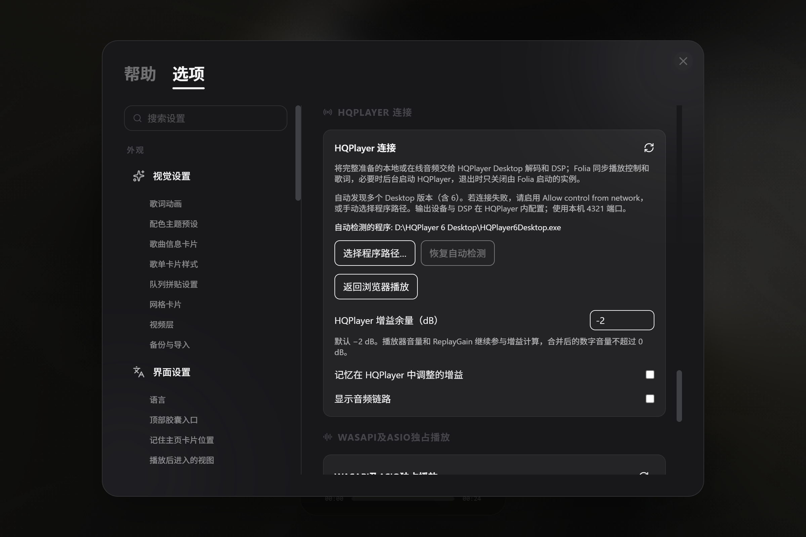
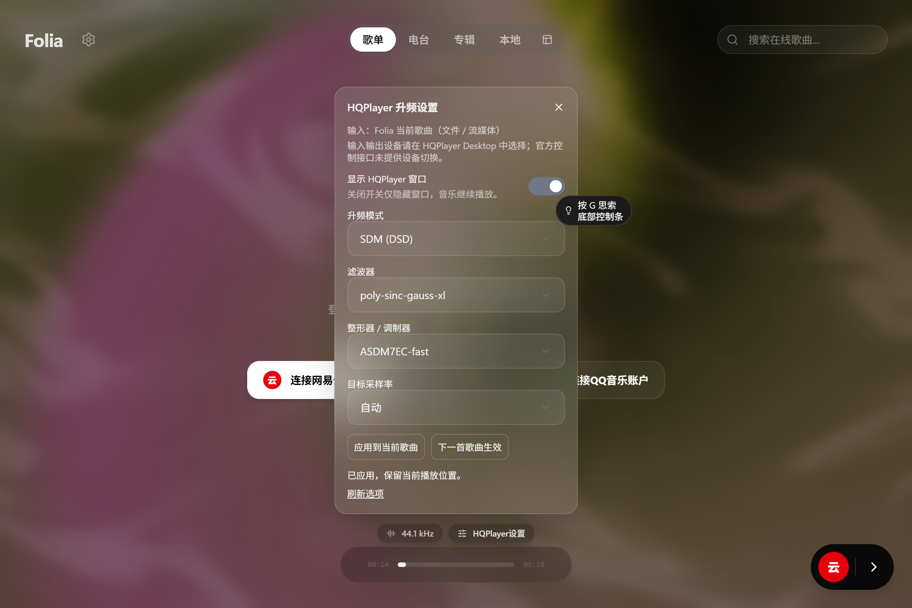

# Folia-HiFi-WASAPI-ASIO-HQPlayer-Spotify

基于 [Folia](https://github.com/chthollyphile/folia-major) 的个人公益、非商业维护 fork，由 [PekolandBBQ](https://github.com/PekolandBBQ) 维护。保留原有歌词与音乐库体验，追加 Windows WASAPI/ASIO 独占输出、HQPlayer 连接、整数 PCM、音频链路，以及 **Spotify 桌面客户端接入**。

当前正式修订为 **0.7.12 r4**，标签为 `folia-hifi-v0.7.12-r4`。应用版本继续与上游保持一致，为 **0.7.12**；修订号只用于区分本 fork 的发行件。原项目署名和许可证保留，专版独立维护。

[下载 Windows x64 正式版](https://github.com/PekolandBBQ/Folia-HiFi-WASAPI-ASIO-HQPlayer/releases/tag/folia-hifi-v0.7.12-r4) · [使用说明](docs/exclusive/USAGE.md) · [本次更新说明](docs/exclusive/releases/0.7.12-r4.md) · [验证结果](docs/exclusive/VALIDATION.md) · [反馈问题](https://github.com/PekolandBBQ/Folia-HiFi-WASAPI-ASIO-HQPlayer/issues)

**Spotify 适用平台：Windows 10（1803 或更新）/ Windows 11 x64。r4 在用户系统上自动选择可用的应用音频路由接口，不再限定 10.0.28000；无需用户安装编译工具或自行构建。** 完成一键安装、配置后正常点歌即可。当前本机为 28000、Microsoft Store 版；其他 Windows 的接口选择有代码测试，尚无那些系统的完整实播结果。全新 Windows 上的 Spicetify 首次安装仍待验证，已有组件和备份继续复用。

## 我追加了哪些功能

| 功能 | 实际体验 |
| --- | --- |
| **Spotify 接入** | 使用 Wrapper、Spicetify 桥接与 VB-CABLE 实时采集，将 Spotify 歌单歌曲接入 Folia 的 WASAPI、ASIO、HQPlayer 和整数模式；播放来自用户本机 Spotify 客户端 |
| **首次使用向导** | 检测官网桌面版和 Microsoft Store 版；未安装时提示用户自行安装。固定版本组件“一键安装”紧接“一键配置”，提示首次驱动安装重启，并引导 Windows 默认输出选择实际扬声器或 DAC |
| **后台启动与桌面协同** | 点歌时可后台拉起 Spotify，左下角显示启动准备；Spotify 桌面换歌后 Folia 自动暂停，用户选择追随歌曲/进度，或直接交还 Spotify 播放。退出 Folia 或实际切换音源时选择是否同时退出由 Folia 拉起的 Spotify |
| **Spotify 封面与原歌词** | 已点赞歌曲以九首歌曲封面组成九宫格；有可用原歌词时回传 Spotify 歌曲自带歌词，缺失内容不冒充原歌词 |
| **WASAPI / ASIO 独占输出** | 在设置中选择设备；切换输出保留歌曲、检查点和播放/暂停意图，本地、QQ、网易云等音源仍经过原有 Folia 播放链路 |
| **HQPlayer 独立连接** | 自动发现或选择本机 HQPlayer Desktop；支持静默启动、显示/隐藏窗口、DSP 当前曲/下一曲应用、输出切换续播、官方时钟及音频链路回报 |
| **整数 PCM 与音频链路** | 可选整数处理，音量和 ReplayGain 仍生效；显示实际读取的音源、输出格式和增益，未回报的数据明确标为未知 |
| **短缺口继续播放** | Spotify 采集出现不连续标记时，位置连续则继续；已知缺口不超过 100 毫秒时补等长静音。较大、未知缺口仍提示失败；补偿区间不称 bit-perfect |

## 下载与开始使用

1. 从 [0.7.12 r3 Release](https://github.com/PekolandBBQ/Folia-HiFi-WASAPI-ASIO-HQPlayer/releases/tag/folia-hifi-v0.7.12-r4) 下载 **[EXE 安装版](https://github.com/PekolandBBQ/Folia-HiFi-WASAPI-ASIO-HQPlayer/releases/download/folia-hifi-v0.7.12-r3/Folia-HiFi-WASAPI-ASIO-HQPlayer-0.7.12-win-x64-Setup.exe)**，或 **[ZIP 免安装版](https://github.com/PekolandBBQ/Folia-HiFi-WASAPI-ASIO-HQPlayer/releases/download/folia-hifi-v0.7.12-r3/Folia-HiFi-WASAPI-ASIO-HQPlayer-0.7.12-win-x64.zip)**。ZIP 完整解压后运行其中的 EXE；更新前先退出旧版。
2. 两种方式共用 `%APPDATA%\Folia HiFi`。已有配置保留；旧 `FoliaExclusive` 仅在目标目录不存在时复制迁移，不合并或覆盖。
3. 使用 Spotify 时，先自行安装官网桌面版或 Microsoft Store 版，启动并登录账号。在 Folia 点击“连接 Spotify”，按向导选择安装版本。
4. 按顺序点击“① 一键安装”及“② 一键配置”。首次安装/重装 VB-CABLE 后按提示重启，再“重新检查”；Windows 默认输出应选实际扬声器或 DAC，不能选 CABLE Input / CABLE In 16ch。配置步骤按向导提示正常退出 Spotify，已有组件和备份继续沿用。
5. 完成后“启动并连接 Spotify”，就绪后“完成并返回歌单”，在 Folia 点歌。需要 HQPlayer 时自行安装、授权 Desktop，配置 DAC/DSP 和 `Allow control from network`，再启用 Folia 的 HQPlayer 连接。

Spotify 内暂停、停止、切歌、Seek 和后端切换保留路由；暂停/停止会停止采集。仅退出 Folia、实际播放其他流媒体/本地音源，或明确交还 Spotify 播放时恢复路由。Folia 不自动查询或修改 Spotify 音量。

完整步骤、组件版本、桌面协同和退出说明见 [使用方法](docs/exclusive/USAGE.md)。HQPlayer Desktop 与 Spotify 客户端不包含在发行包内；Spicetify、VB-CABLE 按固定版本由向导准备，无需用户安装 Node 或 .NET SDK。

## 本次修复与验证

- 修复暂停后立即 Seek 可能漏发暂停命令：Seek 改变位置，不取消用户的暂停意图。
- 修复 Microsoft Store Spotify 启动脚本缺少资源文件，以及没有实际路由时退出误报恢复失败。
- 实际采集约 78 毫秒缺口补偿后继续交付；旧 everscape 间歇中断记录保留。
- 当前测试口径为 **7024 项单测通过、0 失败、2 项原有跳过**，类型检查、构建、包内代码核对及 EXE/ZIP 主要文件一致性通过。退役测试与迁移原因可审查。
- 最新实播、HQPlayer、跨音源和整数模式结果按各自日期/组件版本记录；r3 工程修复没有重新跑整套真机矩阵。三秒性能与偶发 Seek 保留观察。

## 实际界面

以下为本 fork 已保存的真实设置界面，Spotify 首次向导以实际程序为准。

## 使用边界

- Windows x64 专版；本次不提供 macOS/Linux 的这些原生扩展。Spotify 的构建号限制见页首。
- Spotify 使用实时 PCM；其他流媒体可采用渐进准备，具体由源和后端决定。没有承诺无缝切歌、外部后端 automix 或三秒内实际出声。
- 整数处理不等于源文件到 DAC 全链路 bit-perfect；软件增益、Windows 混音、Spotify 客户端和 HQPlayer DSP 都会影响链路，补静音区间另行记录。
- 当前硬件证据主要来自 XingCore DAC 与 HQPlayer Desktop 6；其他驱动与 DSP 配置需要各自验证。发行件尚未代码签名，请核对 Release 的 SHA256SUMS。

源码、构建、验证与维护约束见 [MAINTAINING](docs/exclusive/MAINTAINING.md)。

Folia-HiFi-WASAPI-ASIO-HQPlayer-Spotify is an independently maintained, personal noncommercial Windows x64 fork of Folia. It adds Spotify desktop integration, WASAPI/ASIO output, HQPlayer control, integer PCM and signal-path reporting. Revision r4 automatically selects the available per-app routing interface on Windows 10 (1803+) and Windows 11 x64; users do not need compilers or an exact kernel build. The application version remains 0.7.12; fork revision r4 uses a separate release tag.

---

Folia 上游项目介绍、使用方式与贡献者（保留原文）

  

# Folia

Lyrics Reimagined // 辞曲新境

<!-- ALL-CONTRIBUTORS-BADGE:START - Do not remove or modify this section -->

<!-- ALL-CONTRIBUTORS-BADGE:END -->

[获取方式](https://github.com/chthollyphile/folia-major#%E8%8E%B7%E5%8F%96%E6%96%B9%E5%BC%8F)
·
[Vercel 部署](https://vercel.com/new/clone?repository-url=https://github.com/chthollyphile/folia-major)
·
[使用指南](https://folia-site.cielaniska.top/guide/)
·
[技术说明](docs/technical.md)

## 项目简介

Folia是一个以全屏沉浸式歌词播放为核心的在线音乐播放器，支持网易云、酷狗、Navidrome 和本地音乐库，通过智能歌词匹配，AI生成配色主题，以及多种全屏歌词动画为用户提供独特的听歌体验。

提供基于Electron的 windows/ macOS/ Linux 桌面端版本与基于 Node.js 的 Web 版本，支持多平台部署。

如果希望能够在移动设备上使用，或在浏览器上体验，可以选择[一键部署到 Vercel](https://folia-site.cielaniska.top/guide/deploy-vercel) 的 Web 版本，或自行部署到其他支持 Node.js 的平台。

## 展示

### 演示视频

https://github.com/user-attachments/assets/af806cf1-f67f-4b88-b2e7-57db507e9e81

https://github.com/user-attachments/assets/fd27f4f0-64b9-4c57-8c3b-10df767f934b

https://github.com/user-attachments/assets/704f195a-2194-434b-86e8-8f36290e5cc4

### 部分主题预览

<table>
  <tr>
    <td width="50%">
      
    </td>
    <td width="50%">
      
    </td>
  </tr>
  <tr>
    <td align="center"><strong>浮名</strong></td>
    <td align="center"><strong>流光</strong></td>
  </tr>
  <tr>
    <td width="50%">
      
    </td>
    <td width="50%">
      
    </td>
  </tr>
  <tr>
    <td align="center"><strong>心象</strong></td>
    <td align="center"><strong>云阶</strong></td>
  </tr>
  <tr>
    <td width="50%">
      
    </td>
    <td width="50%">
      
    </td>
  </tr>
  <tr>
    <td align="center"><strong>群唱</strong></td>
    <td align="center"><strong>倾诉</strong></td>
  </tr>
    <tr>
    <td width="50%">
      
    </td>
    <td width="50%">
      
    </td>
  </tr>
  <tr>
    <td align="center"><strong>镜台</strong></td>
    <td align="center"><strong>时计</strong></td>
  </tr>
</table>

不同的歌词动画具有不同的排版氛围和可调参数，让全屏歌词拥有如同文字PV般的丰富视觉效果，同时又能兼顾响应式布局，自动适配不同窗口尺寸。

## 核心能力

| 模块 | 说明 |
| --- | --- |
| 在线搜索与播放 | 搜索歌曲、歌手或专辑后即可播放，并自动加载相关封面与歌词。 |
| 本地音乐支持 | 可导入本地音频文件，在本地安全保存索引信息，不上传文件内容。详细用法见 [本地音乐库管理](docs/local-library-management.md)。 |
| 智能歌词匹配 | 本地歌曲可自动匹配在线歌词与封面，也支持手动修正匹配结果。 |
| 本地歌词文件识别 | 自动加载同目录同名 `.lrc`、`.vtt`、`.ttml`、`.qrc`、`.yrc`、`.krc` 歌词文件，或歌词文件内嵌 LRC 歌词。适配 LDDC 生成的增强型逐字歌词格式。 |
| Now Playing 接入 | 支持通过本机 [Now Playing](https://github.com/Widdit/now-playing-service/) 服务接入外部播放器的歌曲、时间轴与歌词信息，并驱动 Folia 的舞台视图与全屏歌词渲染。 |
| AI 主题生成 | 基于歌曲情绪与歌词内容生成沉浸式背景与视觉参数。 |
| 多端体验 | 提供 Web 部署方式，同时支持桌面端打包分发。 |
| 模组系统（实验性） | 桌面版可通过 Folium 模组添加歌词动画、背景、播放页图层、命令等，并从 [模组市场](https://folium-compound.vercel.app) 安装官方认证的模组。详见 [模组系统](#模组系统folium-v1x)。 |

## 获取方式

桌面版内置前后端运行环境，适合希望即装即用的用户。

### 一键部署

如果你希望快速上线 Web 版本，请阅读 [Vercel 一键部署指南](https://folia-site.cielaniska.top/guide/deploy-vercel) 来创建项目

 

项目也支持一键部署到 Cloudflare，请参考 Vercel 的部署教程进行相应调整。

Vercel 与 Cloudflare 上的 QQ 音乐不再需要额外部署一个常驻 API 实例：把 `VITE_QQ_API_BASE` 填成 `/api/qq`，再配一个 `QQ_SESSION_SECRET`（服务端密钥，**不加 `VITE_` 前缀**）即可。这种形态默认只支持微信扫码登录，且播放前必须先登录；Cloudflare 上可以再绑定一个 Durable Object，增加 QQ 扫码登录方式。完整步骤、平台差异和排错方法见 [QQ 音乐部署指南](docs/qq-music-deployment.md)。

自托管用户可以使用 [Docker Compose 全栈部署](deploy/docker/README.md)。本地音乐目录访问依赖可信 HTTPS 安全上下文，部署文档包含 NAS 反向代理和证书要求。

关于移动端：

目前推荐移动端用户部署 Web 版本/自托管版本之后，通过chrome for android / iOS Safari 创建 PWA应用（也就是将网页应用添加到桌面，Folia web版本支持安装为PWA应用）来使用。

有一定技术的用户可以使用 capacitor 将本项目的web版本打包成为可安装的安卓apk，具体方法可参考示范仓库：[chthollyphile/folia-sonnet](https://github.com/chthollyphile/folia-sonnet)

### 直接下载

- **Windows / macOS / Linux**: 最新版本的安装包请前往 [Releases 页面](https://github.com/chthollyphile/folia-major/releases/latest) 下载。
- **Arch Linux**: 可通过 AUR 获取 [folia-major-bin](https://aur.archlinux.org/packages/folia-major-bin)。
- **Flatpak**: 社区提供的第三方 flatpak，详情见 [Flatpark](https://flatpark.org/apps/top.izuna.foliamajor/)。

> [!IMPORTANT]
> 如果国内网络从 GitHub Releases 下载较慢，可以使用 [夸克网盘](https://pan.quark.cn/s/6e4c6fa3bc6f) 或 [百度云](https://pan.baidu.com/s/1f0x3g-8PMcNCO-TJ5z1rPw?pwd=flia) 下载。网盘链接仅提供 Windows 与 Apple silicon 的正式版安装包.

Linux 包、Wayland / Hyprland 遥控窗和桌面端细节见 [技术与开发说明](docs/technical.md)。

## 文档与开发

更完整的使用说明请访问 [Folia Guide](https://folia-site.cielaniska.top/guide/)。

部署、环境变量、本地开发、Stage API、常用脚本和技术栈见 [技术与开发说明](docs/technical.md)。

## 模组系统（Folium v1.x）

> [!NOTE]
> 模组系统是实验性功能，仅桌面版可用，默认关闭，需要在「设置 → 实验室 → 模组系统」中开启。

Folium 是 Folia 的模组平台。模组可以添加新的歌词动画模式和背景类型、在播放页上叠加内容、给进度条加按钮和标记、注册命令与设置分区、在歌词显示前改写歌词，也可以通过 Node 入口调用 ffmpeg 等本地能力。模组以可信代码运行，每个模组在启用前都要在原生窗口中确认，文件变化后需要重新确认。

- **模组市场**：[folium-compound.vercel.app](https://folium-compound.vercel.app) 提供官方模组和经过审查的社区模组，下载 zip 后拖进模组面板即可安装。
- **官方认证**：市场里的模组都带有 Folium 签名，安装后显示「官方认证」；没有签名的第三方模组显示「未验证」，同样可以使用。
- **开发与贡献**：[模组开发与贡献指南](docs/folium/contributing.md)，从写第一个模组、本地调试，到提交到模组市场、审查与签名、发布更新。
- **API 参考**：[Folium API 参考](docs/folium/api.md)，由契约文件生成的完整接口文档，按注册表、上下文、事件、服务等分类查询。
- **平台规范**：[Folium 规范](mods/README.md)，包括清单字段、权限、注册表语义、事件、安全模型与版本策略。
- **示范模组**：仓库的 [`mods/`](mods/) 目录，覆盖歌词动画、调参、进度条、播放页图层与透明视频导出。

## Sync Server

Folia 提供了可选的官方同步服务端 `sync-server`，用于在多个设备之间同步外观设置与 AI 主题库。服务端由用户自行托管，适合希望跨设备同步配色主题的用户。

支持以下部署方式：

- **Cloudflare Workers / D1**：免服务器运维的 Serverless 部署，推荐使用。
  
- **Docker**：镜像与 Compose 入口见 [Docker 部署目录](deploy/docker/README.md)。
- **Node.js 自托管**：使用 SQLite，适合本地或不方便使用 Docker 的环境。

详细的环境变量、Token 配置与部署步骤请参阅 [Sync-Server 部署指南](https://folia-site.cielaniska.top/guide/deploy-sync)。部署完成后，在 Folia 的“存储设置”中填写服务端地址和 `SYNC_TOKEN` 即可启用同步。

## 本地音乐与匹配说明

Folia 会读取音频文件元数据、同目录歌词和封面，并可通过网易云、QQ 音乐或酷狗音乐补全歌曲信息。自动匹配按网易云、QQ、酷狗依次回退；匹配不准确时，可以手动选择候选、恢复首次导入的本地信息，或进一步合并、拆分艺术家与专辑实体。

完整的导入、重扫、匹配、实体编辑、歌单、缓存和故障排查说明见 [本地音乐库管理](docs/local-library-management.md)。

## Community

加入discord社群，共同交流，获得帮助

## 贡献者

感谢所有为本项目进行 Issue 提交、Bug 报告、想法建议、测试与代码编写的贡献者，均依据 all-contributors 规范进行统计

由于列表过长，贡献记录请见 [贡献者名单](CONTRIBUTORS.md)。

## 法律与免责声明

本项目在 AI 的广泛协助下开发，因此仍可能存在细微或不易察觉的问题。若给你带来不便，敬请理解。

本项目主要用于展示播放动效、界面设计与相关工程实现。应用中涉及的在线音乐流媒体、歌词、专辑封面及其他内容，其版权均归对应权利人所有。

本仓库及其源代码仅供个人学习、技术交流与非营利测试使用。请勿将其用于商业盈利用途。若因对在线资源的传播、加工或再分发而引发版权纠纷或其他责任，均由使用者自行承担，项目开发者不承担相关责任。

请始终尊重数字版权，并在条件允许时通过官方平台支持正版音乐。

## 致谢

特别感谢以下项目和资源：

- [chenmozhijin/LDDC](https://github.com/chenmozhijin/LDDC)
- [NeteaseCloudMusicApiEnhanced](https://github.com/NeteaseCloudMusicApiEnhanced/api-enhanced)
- [chenglou/pretext](https://github.com/chenglou/pretext)
- [MakcRe/KuGouMusicApi](https://github.com/MakcRe/KuGouMusicApi)
- [paper-design/shaders](https://github.com/paper-design/shaders)
- [yakult-green-tea/qq-music-api](https://github.com/yakult-green-tea/qq-music-api)

本项目接入了 [Apple Music-like Lyrics TTML 逐词歌词库](https://github.com/amll-dev/amll-ttml-db) 以提供高质量的歌词文件，感谢此歌词库的作者和贡献者们。

## 许可证

本项目基于 `AGPL-3.0` 许可证开源。

