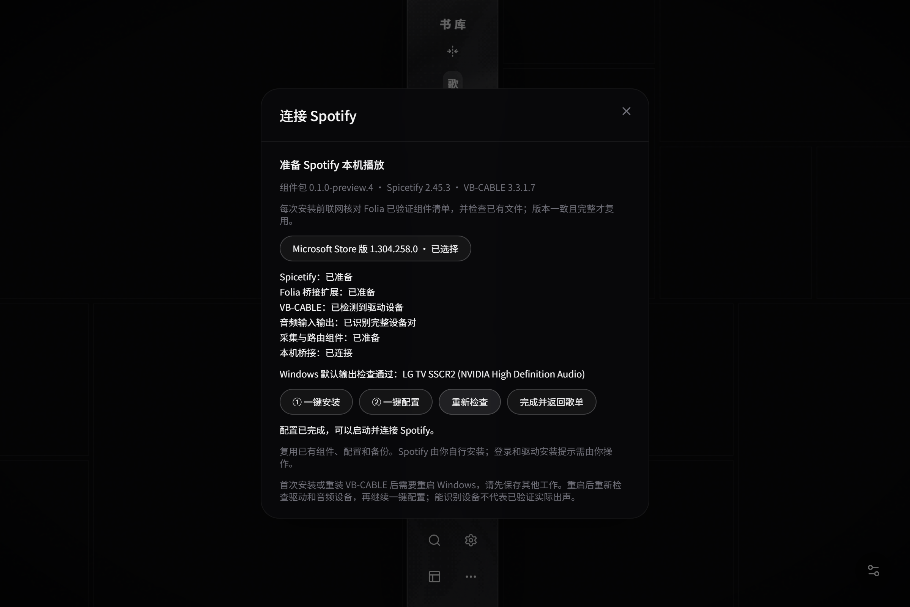
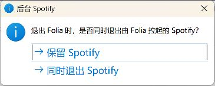
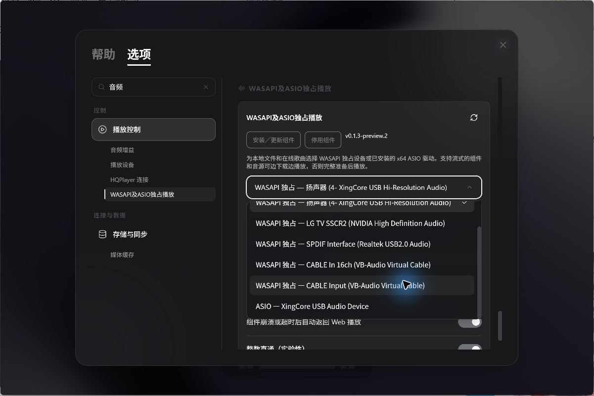
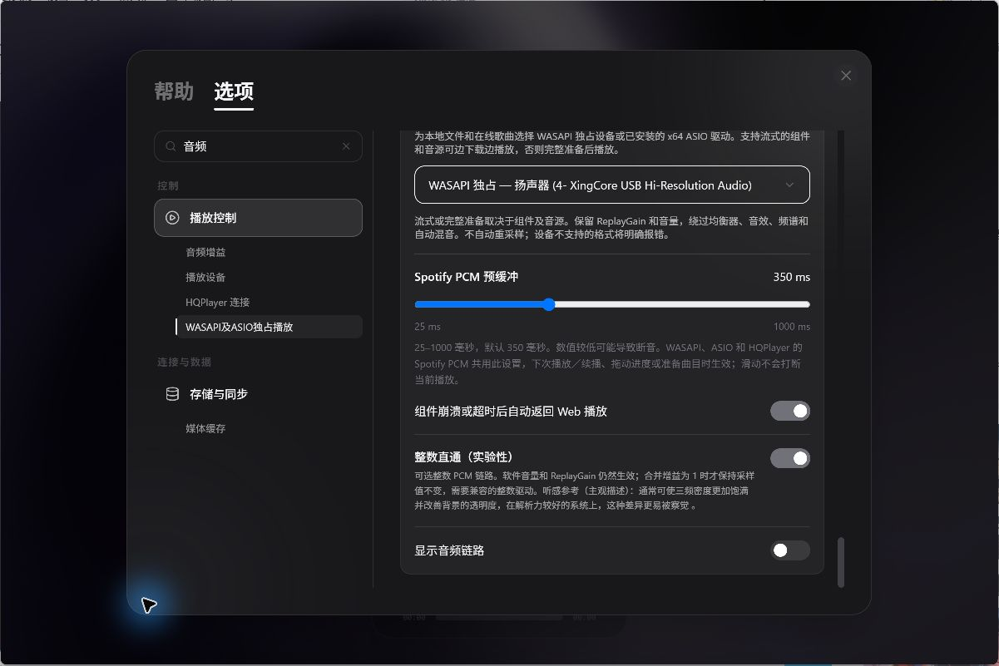
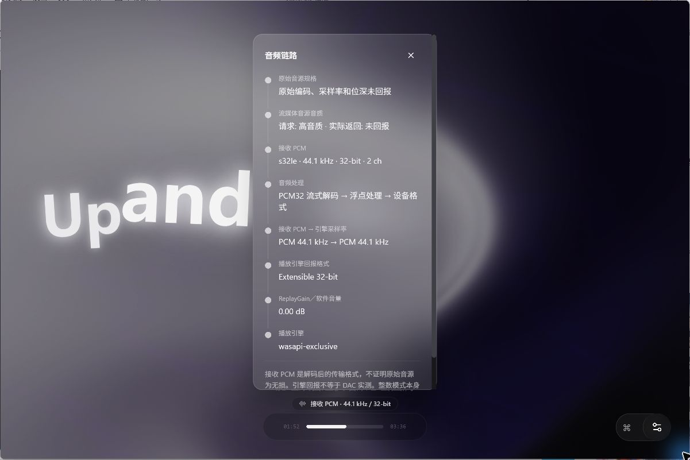
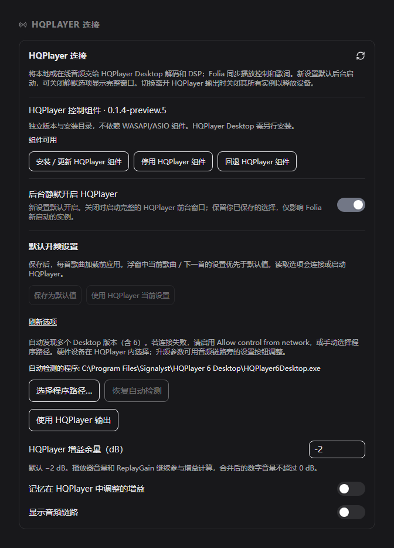

# Folia-HiFi-WASAPI-ASIO-HQPlayer-Spotify

基于 [Folia](https://github.com/chthollyphile/folia-major) 的个人公益、非商业维护 fork，由 [PekolandBBQ](https://github.com/PekolandBBQ) 维护。保留原有歌词与音乐库体验，追加 Windows WASAPI/ASIO 独占输出、HQPlayer 连接、整数 PCM、音频链路，以及 **Spotify 桌面客户端接入**。

当前正式发行件为 **0.7.19 r5**，标签为 `folia-hifi-v0.7.19-r5`，已同步上游稳定版 **0.7.19** 并保留 HiFi 与 Spotify Wrapper 功能。修订号用于区分本 fork 的发行件，原项目署名和许可证保留，专版独立维护。

[下载 Windows x64 正式版](https://github.com/PekolandBBQ/Folia-HiFi-WASAPI-ASIO-HQPlayer/releases/tag/folia-hifi-v0.7.19-r5) · [使用说明](docs/exclusive/USAGE.md) · [本次更新说明](docs/exclusive/releases/0.7.19-r5.md) · [验证结果](docs/exclusive/VALIDATION.md) · [反馈问题](https://github.com/PekolandBBQ/Folia-HiFi-WASAPI-ASIO-HQPlayer/issues)

**Spotify 进程专属采集适用平台：Windows 11 x64（Windows 应用进程回环 API 要求构建号至少 20348）。不绑定某台机器的内核版本；常规 Windows 10 不支持本次采集入口。**

## 我追加了哪些功能

| 功能 | 实际体验 |
| --- | --- |
| **Spotify 接入** | 使用 Wrapper、Spicetify 桥接与 Windows Spotify 进程专属采集，将 Spotify 歌单歌曲接入 Folia 的 WASAPI、ASIO、HQPlayer 与整数模式；播放来自用户本机 Spotify 客户端 |
| **首次使用向导** | 检测官网桌面版和 Microsoft Store 版；未安装时提示用户自行安装。“一键安装”前联网核对 Folia 最新已验证组件组合和已有文件完整性，随后“一键配置”；提示首次驱动安装重启，并说明 Windows 默认输出与 Spotify 专属采集的区别 |
| **后台启动与桌面协同** | 点歌时可后台拉起 Spotify，左下角显示启动准备；Spotify 桌面换歌后 Folia 自动暂停，用户选择追随歌曲/进度，或直接交还 Spotify 播放。退出 Folia 不弹窗阻止退出，默认保留 Spotify；切换音源时保留 Spotify；可在 Spotify 连接设置中开启“退出 Folia 时自动退出 Spotify”，默认关闭 |
| **Spotify 封面与原歌词** | 已点赞歌曲以九首歌曲封面组成九宫格；有可用原歌词时回传 Spotify 歌曲自带歌词，缺失内容不冒充原歌词 |
| **WASAPI / ASIO 独占输出** | 在设置中选择设备；切换输出保留歌曲、检查点和播放/暂停意图，本地、QQ、网易云等音源仍经过原有 Folia 播放链路 |
| **流式输出** | 支持流式的在线音源边下载、边解码、边输出；Spotify 使用实时 PCM 采集与交付。由音源与输出组件自动选择链路，准备好初始缓冲即可开始，不要求先下载完整歌曲；不支持渐进解码的格式或输出回到完整准备 |
| **HQPlayer 独立连接** | 自动发现或选择本机 HQPlayer Desktop；支持静默启动、显示/隐藏窗口、DSP 当前曲/下一曲应用、输出切换续播、官方时钟及音频链路回报 |
| **整数 PCM 与音频链路** | 可选整数处理，音量和 ReplayGain 仍生效；显示实际读取的音源、输出格式和增益，未回报的数据明确标为未知 |
| **短缺口继续播放** | Spotify 采集出现不连续标记时，位置连续则继续；已知缺口不超过 100 毫秒时补等长静音。较大、未知缺口仍提示失败；补偿区间不称 bit-perfect |

## Spotify 在线搜索与自动连接

Spotify 搜索覆盖在线曲库；点赞或取消点赞会写入 Spotify，并在确认后刷新已点赞歌单。账号已连接时，启动 Folia 会自动尝试完成安装、配置和连接，正常状态直接复用。切换 Spotify 不弹向导；只有打开 Spotify 歌单且三次静默重试仍失败时才显示原因和配置入口。Spotify 尚未安装、登录或 Windows 驱动授权/重启仍需用户操作。

## 双源更新

[GitHub 正式发行版](https://github.com/PekolandBBQ/Folia-HiFi-WASAPI-ASIO-HQPlayer/releases/latest) · [Gitee 国内下载](https://gitee.com/pekoland-bbq/folia-hi-fi-wasapi-asio-hqplayer/releases)

启动后后台检查本 fork 的正式版本，可选择 GitHub、Gitee 或自动换源。安装版支持应用内下载，确认后正常退出并安装；便携版提供 ZIP 下载。内部构建编号用于识别同版本覆盖，不会自动安装或阻塞播放。Gitee 从 r5 开始同步同一次构建的安装包、便携包和更新清单，源码结构及说明与 GitHub 保持一致。

## 下载与开始使用

1. 从 [0.7.19 r5 Release](https://github.com/PekolandBBQ/Folia-HiFi-WASAPI-ASIO-HQPlayer/releases/tag/folia-hifi-v0.7.19-r5) 下载 **[EXE 安装版](https://github.com/PekolandBBQ/Folia-HiFi-WASAPI-ASIO-HQPlayer/releases/download/folia-hifi-v0.7.19-r5/Folia-HiFi-WASAPI-ASIO-HQPlayer-0.7.19-win-x64-Setup.exe)**，或 **[ZIP 免安装版](https://github.com/PekolandBBQ/Folia-HiFi-WASAPI-ASIO-HQPlayer/releases/download/folia-hifi-v0.7.19-r5/Folia-HiFi-WASAPI-ASIO-HQPlayer-0.7.19-win-x64.zip)**。ZIP 完整解压后运行其中的 EXE；更新前先退出旧版。
2. 两种方式共用 `%APPDATA%\Folia HiFi`。已有配置保留；旧 `FoliaExclusive` 仅在目标目录不存在时复制迁移，不合并或覆盖。
3. 使用 Spotify 时，先自行安装官网桌面版或 Microsoft Store 版，启动并登录账号。在 Folia 点击“连接 Spotify”，按向导选择安装版本。
4. 联网后按顺序点击“① 一键安装”及“② 一键配置”。组件版本一致且文件完整才复用；首次安装/重装 VB-CABLE 后按提示重启，再“重新检查”。Windows 默认输出回落到 VB-CABLE 不再阻断 Spotify 的原生输出。配置时 Folia 自动暂停并退出受控 Spotify；旧版中断的备份保留，修正版使用新的私有资源目录完成首次配置。
5. 配置完成后自动启动并连接 Spotify，就绪后“完成并返回歌单”，在 Folia 点歌。需要 HQPlayer 时自行安装、授权 Desktop，配置 DAC/DSP 和 `Allow control from network`，再启用 Folia 的 HQPlayer 连接。

Spotify 内暂停、停止、切歌、Seek 和后端切换保留路由；暂停/停止会停止采集。仅退出 Folia、实际播放其他流媒体/本地音源，或明确交还 Spotify 播放时恢复路由。Folia 不自动查询或修改 Spotify 音量。

完整步骤、组件版本、桌面协同和退出说明见 [使用方法](docs/exclusive/USAGE.md)。HQPlayer Desktop 与 Spotify 客户端不包含在发行包内；Spicetify、VB-CABLE 按 Folia 已验证组件组合由向导准备，无需用户安装 Node 或 .NET SDK。

## 本次修复与验证

- 统一 Spotify 进程采集的准备、续播、Seek 和输出切换条件；临时无活动端点会话不再误判失败。保留进程身份与清理检查，避免旧失败持续拦住后续播放。
- 修复快速点歌、上一首/下一首和旧曲结束事件交错时的歌曲错位。拼贴页切歌后留在歌单，定位展开当前歌曲卡片并显示滚动歌词；仅明确进入播放页时跳转，定位沿用上游最小平移。
- 改善 Spotify 原歌词等待与缓存，过期请求不覆盖新歌；确认没有歌词时，详情页和卡片显示“当前歌曲无歌词或为纯音乐，请欣赏”。加载中与请求失败不显示这条提示。
- 可恢复的短暂故障先做有界静默重试，界面显示具体中文原因，原始错误码与阶段留在日志。
- r5 新增双源更新、首次冷启动恢复与连接进度；验证范围和保留的问题见 [r5 更新说明](docs/exclusive/releases/0.7.19-r5.md)。

**已知问题：Spotify 经 HQPlayer 输出目前仍可能出现断续播放，r5 尚未解决。增加预缓冲或降低 DSP 负载可能缓解，但不视为修复。三秒性能和历史偶发 Seek 继续观察。**

## 实际界面

图片展示本 fork 的操作入口；HQPlayer 设置图由当前代码离线渲染，其余截图来自本机实际界面。播放、恢复和性能结论见 [验证结果](docs/exclusive/VALIDATION.md)。

**Spotify 首次使用向导**：检测桌面版 / Microsoft Store 版，安装前联网核对已验证组件组合，显示版本与配置状态；按“一键安装 → 一键配置”的顺序完成准备，随后自动启动并连接。

**Spotify 歌单封面**：已点赞歌曲使用九首歌曲封面组成九宫格；右侧为本机 Spotify 已加载曲目入口。图中歌单来自已有本机资料。

**后台 Spotify 询问（历史截图）**：r5 切换音源与退出时均不再显示此询问。默认保留 Spotify；是否随 Folia 退出由连接设置中的开关决定。

**WASAPI / ASIO 输出**：从实际枚举的设备中选择输出，Spotify PCM 预缓冲可调；整数处理与音频链路显示在同一区域设置。

**流式输出与实际链路**：Spotify 实时 PCM 经初始缓冲后持续交付 WASAPI / ASIO；其他支持渐进解码的在线音源可在下载继续时播放。无需另开“流式模式”，左下角分阶段显示准备与缓冲，音频链路显示实际处理和输出格式；遇到需完整文件索引的格式会先完整准备。

**HQPlayer 独立连接**：检测组件与 Desktop，选择连接和窗口行为；播放时还可在 DSP 面板选择应用于当前曲或下一曲。Spotify 与其他音源一样，选择 HQPlayer 输出后直接播放；Spotify PCM 预缓冲与 WASAPI / ASIO 共用。

查看 HQPlayer DSP 播放面板（此前已保存的实际界面）

## 使用边界

- Windows x64 专版；本次不提供 macOS/Linux 的这些原生扩展。Spotify 的系统范围与验证边界见页首。
- Spotify 使用实时 PCM；其他流媒体可采用渐进准备，具体由源和后端决定。没有承诺无缝切歌、外部后端 automix 或三秒内实际出声。
- 整数处理不等于源文件到 DAC 全链路 bit-perfect；软件增益、Windows 混音、Spotify 客户端和 HQPlayer DSP 都会影响链路，补静音区间另行记录。
- 当前硬件证据主要来自 XingCore DAC 与 HQPlayer Desktop 6；其他驱动与 DSP 配置需要各自验证。发行件尚未代码签名，请从本仓库 Release 下载。

源码、构建、验证与维护约束见 [MAINTAINING](docs/exclusive/MAINTAINING.md)。

Folia-HiFi-WASAPI-ASIO-HQPlayer-Spotify is an independently maintained, personal noncommercial Windows x64 fork of Folia. Version 0.7.19 r5 integrates upstream 0.7.19 while retaining Spotify Wrapper, WASAPI/ASIO, HQPlayer, integer PCM and signal-path reporting. It fixes first-time Spicetify configuration for desktop and Store layouts and checks Folia's latest validated component manifest and installed file integrity before installation. Spotify process capture requires Windows 11 x64 (API build 20348 or newer). Intermittent Spotify playback through HQPlayer remains a known issue in r5. The fork uses a separate release tag.

---

Folia 上游项目介绍、使用方式与贡献者（保留原文）

  

# Folia

Lyrics Reimagined // 辞曲新境

<!-- ALL-CONTRIBUTORS-BADGE:START - Do not remove or modify this section -->

<!-- ALL-CONTRIBUTORS-BADGE:END -->

[获取方式](https://github.com/chthollyphile/folia-major#%E8%8E%B7%E5%8F%96%E6%96%B9%E5%BC%8F)
·
[Vercel 部署](https://vercel.com/new/clone?repository-url=https://github.com/chthollyphile/folia-major)
·
[使用指南](https://folia-site.cielaniska.top/guide/)
·
[技术说明](docs/technical.md)

## 项目简介

Folia是一个以全屏沉浸式歌词播放为核心的在线音乐播放器，支持网易云、酷狗、Navidrome 和本地音乐库，通过智能歌词匹配，AI生成配色主题，以及多种全屏歌词动画为用户提供独特的听歌体验。

提供基于Electron的 windows/ macOS/ Linux 桌面端版本与基于 Node.js 的 Web 版本，支持多平台部署。

如果希望能够在移动设备上使用，或在浏览器上体验，可以选择[一键部署到 Vercel](https://folia-site.cielaniska.top/guide/deploy-vercel) 的 Web 版本，或自行部署到其他支持 Node.js 的平台。

## 展示

### 演示视频

https://github.com/user-attachments/assets/af806cf1-f67f-4b88-b2e7-57db507e9e81

https://github.com/user-attachments/assets/fd27f4f0-64b9-4c57-8c3b-10df767f934b

https://github.com/user-attachments/assets/704f195a-2194-434b-86e8-8f36290e5cc4

### 部分主题预览

<table>
  <tr>
    <td width="50%">
      
    </td>
    <td width="50%">
      
    </td>
  </tr>
  <tr>
    <td align="center"><strong>浮名</strong></td>
    <td align="center"><strong>流光</strong></td>
  </tr>
  <tr>
    <td width="50%">
      
    </td>
    <td width="50%">
      
    </td>
  </tr>
  <tr>
    <td align="center"><strong>心象</strong></td>
    <td align="center"><strong>云阶</strong></td>
  </tr>
  <tr>
    <td width="50%">
      
    </td>
    <td width="50%">
      
    </td>
  </tr>
  <tr>
    <td align="center"><strong>群唱</strong></td>
    <td align="center"><strong>倾诉</strong></td>
  </tr>
    <tr>
    <td width="50%">
      
    </td>
    <td width="50%">
      
    </td>
  </tr>
  <tr>
    <td align="center"><strong>镜台</strong></td>
    <td align="center"><strong>时计</strong></td>
  </tr>
</table>

不同的歌词动画具有不同的排版氛围和可调参数，让全屏歌词拥有如同文字PV般的丰富视觉效果，同时又能兼顾响应式布局，自动适配不同窗口尺寸。

## 核心能力

| 模块 | 说明 |
| --- | --- |
| 在线搜索与播放 | 搜索歌曲、歌手或专辑后即可播放，并自动加载相关封面与歌词。 |
| 本地音乐支持 | 可导入本地音频文件，在本地安全保存索引信息，不上传文件内容。详细用法见 [本地音乐库管理](docs/local-library-management.md)。 |
| 智能歌词匹配 | 本地歌曲可自动匹配在线歌词与封面，也支持手动修正匹配结果。 |
| 本地歌词文件识别 | 自动加载同目录同名 `.lrc`、`.vtt`、`.ttml`、`.qrc`、`.yrc`、`.krc` 歌词文件，或歌词文件内嵌 LRC 歌词。适配 LDDC 生成的增强型逐字歌词格式。 |
| Now Playing 接入 | 支持通过本机 [Now Playing](https://github.com/Widdit/now-playing-service/) 服务接入外部播放器的歌曲、时间轴与歌词信息，并驱动 Folia 的舞台视图与全屏歌词渲染。 |
| AI 主题生成 | 基于歌曲情绪与歌词内容生成沉浸式背景与视觉参数。 |
| 多端体验 | 提供 Web 部署方式，同时支持桌面端打包分发。 |
| 模组系统（实验性） | 桌面版可通过 Folium 模组添加歌词动画、背景、播放页图层、命令等，并从 [模组市场](https://folium-compound.cielaniska.top) 安装官方认证的模组。详见 [模组系统](#模组系统folium-v1x)。 |

## 获取方式

桌面版内置前后端运行环境，适合希望即装即用的用户。

### 一键部署

如果你希望快速上线 Web 版本，请阅读 [Vercel 一键部署指南](https://folia-site.cielaniska.top/guide/deploy-vercel) 来创建项目

 

项目也支持一键部署到 Cloudflare，请参考 Vercel 的部署教程进行相应调整。

Vercel 与 Cloudflare 上的 QQ 音乐不再需要额外部署一个常驻 API 实例：把 `VITE_QQ_API_BASE` 填成 `/api/qq`，再配一个 `QQ_SESSION_SECRET`（服务端密钥，**不加 `VITE_` 前缀**）即可。这种形态默认只支持微信扫码登录，且播放前必须先登录；Cloudflare 上可以再绑定一个 Durable Object，增加 QQ 扫码登录方式。完整步骤、平台差异和排错方法见 [QQ 音乐部署指南](docs/qq-music-deployment.md)。

自托管用户可以使用 [Docker Compose 全栈部署](deploy/docker/README.md)。本地音乐目录访问依赖可信 HTTPS 安全上下文，部署文档包含 NAS 反向代理和证书要求。

关于移动端：

目前推荐移动端用户部署 Web 版本/自托管版本之后，通过chrome for android / iOS Safari 创建 PWA应用（也就是将网页应用添加到桌面，Folia web版本支持安装为PWA应用）来使用。

有一定技术的用户可以使用 capacitor 将本项目的web版本打包成为可安装的安卓apk，具体方法可参考示范仓库：[chthollyphile/folia-sonnet](https://github.com/chthollyphile/folia-sonnet)

### 直接下载

- **Windows / macOS / Linux**: 最新版本的安装包请前往 [Releases 页面](https://github.com/chthollyphile/folia-major/releases/latest) 下载。
- **Arch Linux**: 可通过 AUR 获取 [folia-major-bin](https://aur.archlinux.org/packages/folia-major-bin)。
- **Flatpak**: 社区提供的第三方 flatpak，详情见 [Flatpark](https://flatpark.org/apps/top.izuna.foliamajor/)。

> [!IMPORTANT]
> 如果国内网络从 GitHub Releases 下载较慢，可以使用 [夸克网盘](https://pan.quark.cn/s/6e4c6fa3bc6f) 或 [百度云](https://pan.baidu.com/s/1f0x3g-8PMcNCO-TJ5z1rPw?pwd=flia) 下载。网盘链接仅提供 Windows 与 Apple silicon 的正式版安装包.

Linux 包、Wayland / Hyprland 遥控窗和桌面端细节见 [技术与开发说明](docs/technical.md)。

## 文档与开发

更完整的使用说明请访问 [Folia Guide](https://folia-site.cielaniska.top/guide/)。

部署、环境变量、本地开发、Stage API、常用脚本和技术栈见 [技术与开发说明](docs/technical.md)。

## 模组系统（Folium v1.x）

> [!NOTE]
> 模组系统是实验性功能，仅桌面版可用，默认关闭，需要在「设置 → 实验室 → 模组系统」中开启。

Folium 是 Folia 的模组平台。模组可以添加新的歌词动画模式和背景类型、在播放页上叠加内容、给进度条加按钮和标记、注册命令与设置分区、在歌词显示前改写歌词，也可以通过 Node 入口调用 ffmpeg 等本地能力。模组以可信代码运行，每个模组在启用前都要在原生窗口中确认，文件变化后需要重新确认。

- **模组市场**：[folium-compound.cielaniska.top](https://folium-compound.cielaniska.top) 提供官方模组和经过审查的社区模组，下载 zip 后拖进模组面板即可安装。
- **官方认证**：市场里的模组都带有 Folium 签名，安装后显示「官方认证」；没有签名的第三方模组显示「未验证」，同样可以使用。
- **开发与贡献**：[模组开发与贡献指南](docs/folium/contributing.md)，从写第一个模组、本地调试，到提交到模组市场、审查与签名、发布更新。
- **API 参考**：[Folium API 参考](docs/folium/api.md)，由契约文件生成的完整接口文档，按注册表、上下文、事件、服务等分类查询。
- **平台规范**：[Folium 规范](mods/README.md)，包括清单字段、权限、注册表语义、事件、安全模型与版本策略。
- **示范模组**：仓库的 [`mods/`](mods/) 目录，覆盖歌词动画、调参、进度条、播放页图层与透明视频导出。

## Sync Server

Folia 提供了可选的官方同步服务端 `sync-server`，用于在多个设备之间同步外观设置与 AI 主题库。服务端由用户自行托管，适合希望跨设备同步配色主题的用户。

支持以下部署方式：

- **Cloudflare Workers / D1**：免服务器运维的 Serverless 部署，推荐使用。
  
- **Docker**：镜像与 Compose 入口见 [Docker 部署目录](deploy/docker/README.md)。
- **Node.js 自托管**：使用 SQLite，适合本地或不方便使用 Docker 的环境。

详细的环境变量、Token 配置与部署步骤请参阅 [Sync-Server 部署指南](https://folia-site.cielaniska.top/guide/deploy-sync)。部署完成后，在 Folia 的“存储设置”中填写服务端地址和 `SYNC_TOKEN` 即可启用同步。

## 本地音乐与匹配说明

Folia 会读取音频文件元数据、同目录歌词和封面，并可通过网易云、QQ 音乐或酷狗音乐补全歌曲信息。自动匹配按网易云、QQ、酷狗依次回退；匹配不准确时，可以手动选择候选、恢复首次导入的本地信息，或进一步合并、拆分艺术家与专辑实体。

完整的导入、重扫、匹配、实体编辑、歌单、缓存和故障排查说明见 [本地音乐库管理](docs/local-library-management.md)。

## Community

加入discord社群，共同交流，获得帮助

## 贡献者

感谢所有为本项目进行 Issue 提交、Bug 报告、想法建议、测试与代码编写的贡献者，均依据 all-contributors 规范进行统计

由于列表过长，贡献记录请见 [贡献者名单](CONTRIBUTORS.md)。

## 法律与免责声明

本项目在 AI 的广泛协助下开发，因此仍可能存在细微或不易察觉的问题。若给你带来不便，敬请理解。

本项目主要用于展示播放动效、界面设计与相关工程实现。应用中涉及的在线音乐流媒体、歌词、专辑封面及其他内容，其版权均归对应权利人所有。

本仓库及其源代码仅供个人学习、技术交流与非营利测试使用。请勿将其用于商业盈利用途。若因对在线资源的传播、加工或再分发而引发版权纠纷或其他责任，均由使用者自行承担，项目开发者不承担相关责任。

请始终尊重数字版权，并在条件允许时通过官方平台支持正版音乐。

## 致谢

特别感谢以下项目和资源：

- [chenmozhijin/LDDC](https://github.com/chenmozhijin/LDDC)
- [NeteaseCloudMusicApiEnhanced](https://github.com/NeteaseCloudMusicApiEnhanced/api-enhanced)
- [chenglou/pretext](https://github.com/chenglou/pretext)
- [MakcRe/KuGouMusicApi](https://github.com/MakcRe/KuGouMusicApi)
- [paper-design/shaders](https://github.com/paper-design/shaders)
- [yakult-green-tea/qq-music-api](https://github.com/yakult-green-tea/qq-music-api)

本项目接入了 [Apple Music-like Lyrics TTML 逐词歌词库](https://github.com/amll-dev/amll-ttml-db) 以提供高质量的歌词文件，感谢此歌词库的作者和贡献者们。

## 许可证

本项目基于 `AGPL-3.0` 许可证开源。

---

## 项目基础与致谢

感谢以下项目的作者、贡献者和维护者。本 fork 在 Folia 的基础上扩展 HiFi 输出与 Spotify 接入；下表列出主要项目及其实际用途，相关署名与许可证保留在源码、依赖和发行材料中。

| 项目 / 仓库 | 关系与用途 |
| --- | --- |
| [Folia · chthollyphile/folia-major](https://github.com/chthollyphile/folia-major) | 本 fork 的直接基础，提供播放器、歌词界面、音乐库和多音源框架 |
| [Electron](https://github.com/electron/electron) / [React](https://github.com/facebook/react) | 桌面应用运行与界面框架 |
| [Spicetify CLI](https://github.com/spicetify/cli) | Spotify 客户端扩展的安装与配置基础；本项目在此之上实现 Wrapper 通信与播放协同 |
| [Windows Application Loopback sample](https://github.com/microsoft/Windows-classic-samples/tree/main/Samples/ApplicationLoopback) | Spotify 进程专属采集所用 Windows API 的官方示例与实现参考 |
| [NAudio](https://github.com/naudio/NAudio) | Windows 原生音频组件使用的音频库，支持设备访问、采集及 WASAPI / ASIO 链路 |
| [FFmpeg](https://github.com/FFmpeg/FFmpeg) | 音频解码、格式转换及支持条件下的渐进解码；发行版附对应构建源码与许可证 |
| [NeteaseCloudMusicApiEnhanced](https://github.com/NeteaseCloudMusicApiEnhanced/api-enhanced) | 网易云音乐接口依赖 |
| [yakult-green-tea/qq-music-api](https://github.com/yakult-green-tea/qq-music-api) | QQ 音乐接口依赖 |
| [MakcRe/KuGouMusicApi](https://github.com/MakcRe/KuGouMusicApi) | 酷狗音乐接口依赖 |
| [Apple Music-like Lyrics](https://github.com/amll-dev/applemusic-like-lyrics) | 使用其 TTML 解析组件 |
| [AMLL TTML DB](https://github.com/amll-dev/amll-ttml-db) | 接入的逐词歌词数据来源 |
| [chenglou/pretext](https://github.com/chenglou/pretext) | 文本测量与布局 |
| [paper-design/shaders](https://github.com/paper-design/shaders) | 背景与界面着色器效果 |
| [Borewit/music-metadata](https://github.com/Borewit/music-metadata) | 音乐文件格式、标签和时长解析 |
| [EarTrumpet](https://github.com/File-New-Project/EarTrumpet) | 实现参考：Windows 10 / 11 每应用音频路由接口定义与方法布局 |
| [Music Assistant](https://github.com/music-assistant/server) | 早期 Spotify 方案研究中，参考其官方播放程序、PCM 管道与控制分离的架构 |
| [spotify-player](https://github.com/aome510/spotify-player) | 早期 Spotify 方案研究中，参考其授权、Web API 与播放引擎分离的设计 |

保留 Folia 上游对 [chenmozhijin/LDDC](https://github.com/chenmozhijin/LDDC) 的致谢。Music Assistant 与 spotify-player 属于历史方案参考，当前 Wrapper 无需安装这两个项目。

相关官方软件与资料：[Signalyst HQPlayer Control 源码与接口资料](https://www.signalyst.eu/custom.html)用于 HQPlayer 控制接入；[VB-Audio VB-CABLE](https://vb-audio.com/Cable/)用于 Spotify 的受控音频路由与格式准备。感谢两者提供的工具与资料。
